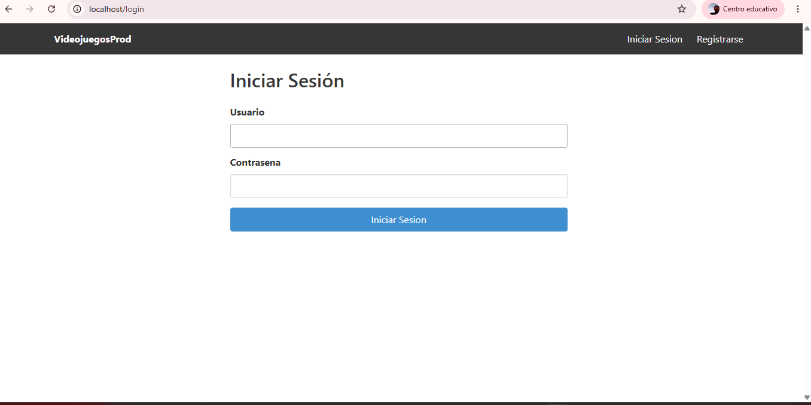
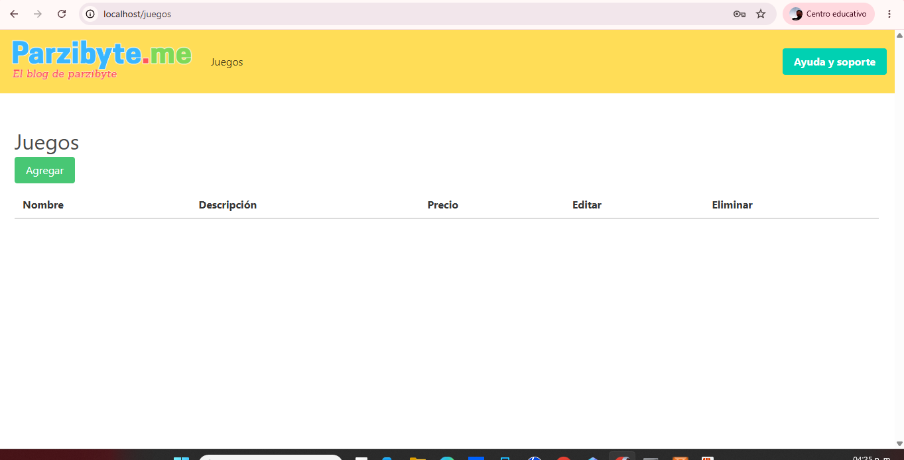

# Mini-Sistema de Videojuegos - Despliegue en Produccion (`videojuegos-prod`)

Aplicacion web desarrollada en **Flask** con autenticacion de usuarios (`Flask-Login`), servidor WSGI de produccion (**Gunicorn**) y base de datos **MySQL 8.0**, contenerizada y orquestada mediante **Docker** y **Docker Compose**.

## 1. Arquitectura y Archivos de Produccion
- `app.py`: Aplicacion Flask unificada (autenticacion y CRUD de videojuegos) configurada mediante `os.environ`.
- `Dockerfile`: Imagen de produccion basada en `python:3.11-slim` ejecutando **Gunicorn** con 3 workers en el puerto `8000`.
- `docker-compose.yml`: Orquestacion de los servicios `web` (Flask + Gunicorn expuesto en `http://localhost`) y `db` (MySQL 8.0 con volumen persistente e inicializacion automatica mediante `init.sql`).

## 2. Variables de Entorno Necesarias

| Variable | Descripcion | Valor por defecto en Docker Compose |
| :--- | :--- | :--- |
| `SECRET_KEY` | Clave secreta para firmar sesiones y tokens CSRF en Gunicorn | `clave-secreta-produccion-videojuegos-2026` |
| `DATABASE_URL` | Cadena de conexion hacia la base de datos MySQL | `mysql+pymysql://videojuegos_user:videojuegos_pass@db:3306/juegos` |
| `MYSQL_ROOT_PASSWORD` | Contrasena del usuario root de MySQL | `rootpassword` |
| `MYSQL_DATABASE` | Nombre de la base de datos | `juegos` |
| `MYSQL_USER` | Usuario de aplicacion en MySQL | `videojuegos_user` |
| `MYSQL_PASSWORD` | Contrasena del usuario de aplicacion | `videojuegos_pass` |

## 3. Pasos para Levantar la Aplicacion en Produccion

1. **Clonar el repositorio:**
   ```bash
   git clone [https://github.com/jonathanaceves2766-debug/videojuegos-prod.git](https://github.com/jonathanaceves2766-debug/videojuegos-prod.git)
   cd videojuegos-prod
   ```

2. **Construir y levantar los contenedores en segundo plano:**
   ```bash
   docker compose up -d --build
   ```

3. **Verificar el estado de los contenedores:**
   ```bash
   docker compose ps
   ```

4. **Acceder a la aplicacion:**
   Abrir en el navegador `http://localhost`, registrar un usuario nuevo, iniciar sesion y gestionar (listar, agregar, editar y eliminar) videojuegos.

## 4. Comandos Docker / Docker Compose Utilizados
```bash
# Construir imagenes y levantar servicios en segundo plano
docker compose up -d --build

# Consultar logs de Flask/Gunicorn y MySQL
docker compose logs -f web

# Detener y eliminar contenedores (conservando volumen de base de datos)
docker compose down
```

## 5. Evidencias de Ejecucion en `http://localhost`

### Registro e Inicio de Sesion


### Catalogo, Alta y Edicion de Videojuegos

